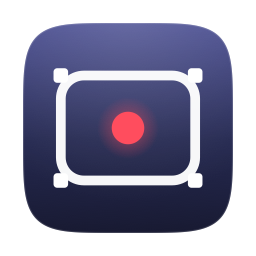

<p align="center">
  
</p>

<h1 align="center">MomentFlow</h1>

<p align="center">macOS 菜单栏录屏小工具：一个按键，把正在看的东西录下来。</p>

<p align="center">
  <a href="README.md">中文</a> ｜ <a href="README.en.md">English</a>
</p>

---

## 这是什么

一个常驻菜单栏的 macOS 应用。看视频、听音乐的时候按一下快捷键，
它会把当前窗口的画面和系统声音录成一个 **mp4**，直接存进文件夹，
不需要打开任何录屏软件。

它只有三个动作：

| 动作 | 默认快捷键 | 说明 |
| --- | --- | --- |
| 快速录制 | `⌘⇧R` | 录当前窗口，再按一次停 |
| 采集片段 | `⌥⌘5` | 打开工具栏，选整屏 / 窗口 / 选区 |
| 记一个点 | `⌥⌘M` | 截一张图，随手写两句 |

快捷键可以在设置里改，改完立即生效。

## 特点

- **只录一个窗口**：只录窗口自己的内容，背景、桌面、其他窗口都不会进来。
  窗口被别的窗口挡住一半，录出来仍然是完整的。
- **画面和系统声音同轨**：默认同时录画面和系统声音，也可以只录声音。
- **平铺输出**：一个录制就是一个文件，录完可以直接拖进剪辑软件。
- **无第三方依赖**：只用系统框架（ScreenCaptureKit、AVFoundation、AppKit、SwiftUI）。
- **录完有提示**：右下角弹出小卡片显示路径，点一下在访达中定位。

## 隐私与安全

**运行时不联网。**

应用本身不发起任何网络请求：没有账号体系，没有遥测，没有崩溃上报，
没有云同步。源码里没有任何 `URLSession` / `Network` 之类的网络调用。

**录制内容只保存在你的电脑上。**

默认位置是 `~/Desktop/MomentFlow/`，可以在设置里改成任意本地文件夹。
录制、截图、笔记都不会上传到任何地方。

**唯一的联网发生在安装阶段**：从 GitHub 下载源码并编译。装好之后，
断网也能正常使用。

需要说明的是：录屏是一项高权限操作，请自行判断你录制和分享的内容是否合适。


## 系统要求

- macOS 14 或更高
- Xcode 或 Xcode Command Line Tools（编译用）

**体积**

- 安装后的 App 约 **2 MB**
- GitHub 源码压缩包约 **1 MB**

## 安装

### 方式一：一行命令

打开「终端」（在启动台里搜 Terminal），复制下面这一整行执行：

```bash
curl -fsSL https://raw.githubusercontent.com/Zniiwax/MomentFlow-macOS/main/Scripts/install.sh | bash
```

它会自动完成：检查系统 → 下载源码 → 编译 → 安装到 `~/Applications` → 打开应用。

第一次运行可能需要先安装 Apple 的命令行开发工具（约 1～2 GB）。
脚本会检测到并弹出安装窗口，点「安装」，等它跑完，再重新执行一次这条命令。

> **国内网络提示**：访问 GitHub 可能需要代理。终端里的 `curl` / `git`
> 不会自动读取系统代理设置，需要按你所用代理软件的方式让终端也走代理。

### 方式二：从 GitHub 页面手动安装（更稳妥）

适合想看清每一步、或者一键命令跑不通的情况。

1. 打开项目主页：<https://github.com/Zniiwax/MomentFlow-macOS>
2. 点右上角绿色的 **Code** 按钮 → **Download ZIP**
3. 双击下载好的 zip 解压（一般会落在「下载」文件夹）
4. 打开「终端」
5. 执行下面这一行：

   ```bash
   cd ~/Downloads/MomentFlow-macOS-main && ./Scripts/build_app.sh && open Dist/MomentFlow.app
   ```

   如果解压后的文件夹不叫 `MomentFlow-macOS-main`，把路径换成实际的名字即可。

6. 如果提示需要安装命令行开发工具，点「安装」，完成后重新执行第 5 步。

整个过程不需要管理员密码。编译产物在 `Dist/MomentFlow.app`。

### 方式三：开发者构建

```bash
git clone https://github.com/Zniiwax/MomentFlow-macOS.git
cd MomentFlow-macOS
swift build
swift test
./Scripts/build_app.sh
open Dist/MomentFlow.app
```

### 可选：让权限在重新编译后仍然有效

macOS 的屏幕录制权限是绑定代码签名的。用 ad-hoc 签名时，每次重新编译，
系统都会把应用当成新的，之前授予的权限会失效。

如果打算反复修改代码，先执行一次：

```bash
./Scripts/setup_signing.sh
```

它会在你的登录钥匙串里创建一张自签名证书，并标记为只用于代码签名。
之后重新编译不需要重新授权。撤销：

```bash
security delete-identity -c "MomentFlow Local Signing"
```

## 首次运行

**第 1 步：打开应用**

安装脚本会自动打开。以后可以在「启动台」或 `~/Applications` 里找到它。

它没有 Dock 图标，也没有主窗口。打开后，屏幕**右上角的菜单栏**会出现一个圆形图标。

**第 2 步：授权屏幕录制**

第一次打开会弹出一个说明窗口。点「授予屏幕录制权限」，
系统会打开 **系统设置 → 隐私与安全性 → 录屏与系统录音**。

在列表里找到 MomentFlow，把开关打开。

如果列表里没有它：点列表下方的「+」，手动选择 `~/Applications/MomentFlow.app`。

**第 3 步：退出并重新打开**

这一步不能省。屏幕录制权限只在程序启动时读取，运行中的进程不会更新。

退出方式：点菜单栏图标 →「退出」，或按 `⌘Q`。

**第 4 步：第一次录制**

先点一下要录的窗口，让它在最前面，然后按 `⌘⇧R`。

菜单栏图标会变成红点并开始计时，再按一次停止。

**第 5 步：允许访问桌面文件夹**

第一次保存时会弹出「想访问你的桌面文件夹」，点允许。
素材默认保存在 `~/Desktop/MomentFlow/`。

## 更新

重新运行一次安装命令即可，它会下载最新源码、重新编译并替换旧版：

```bash
curl -fsSL https://raw.githubusercontent.com/Zniiwax/MomentFlow-macOS/main/Scripts/install.sh | bash
```

如果是在本地克隆的仓库，用：

```bash
./Scripts/update.sh
```

它会拉取最新代码、编译，替换 `~/Applications` 里的那份并重启。

> 如果之前跑过 `./Scripts/setup_signing.sh`，更新后屏幕录制权限会保留；
> 只用 ad-hoc 签名的话，需要重新授权一次。

## 使用

### 快速录制

按 `⌘⇧R`，录制当前活动应用里面积最大的窗口；再按一次停止。

「当前活动」指你最后点击的那个应用，所以按之前先点一下要录的窗口。

### 采集片段

按 `⌥⌘5`，屏幕底部出现工具栏：

- **整屏**：录制鼠标所在的显示器
- **窗口**：鼠标移到哪个窗口，哪个就高亮，点击选中
- **选区**：拖动框选一块区域；松开后仍可拖动边框调整、拖动内部移动

工具栏上可以分别勾选「画面」和「系统声音」：

- 勾了画面 → 输出 `.mp4`
- 只勾声音 → 输出 `.m4a`

按回车或点「开始录制」开始，`Esc` 取消。

### 记一个点

按 `⌥⌘M`，截一张图并弹出小窗口写笔记，自动保存。

### 录制中

菜单栏图标会变成红点并显示时长。工具栏变成控制条，可以停止或丢弃。
录制中退出应用会先等文件写完再退出。

### 从菜单栏操作

不想记快捷键也可以。点屏幕右上角的圆形图标，菜单里有：

- **采集片段…** —— 打开底部工具栏
- **快速录制当前窗口 / 停止录制**
- **记一个点**
- **打开素材库** —— 在访达里打开素材文件夹
- **打开最近一个记录** —— 在访达里定位到最近那段录像
- **设置…** —— 改快捷键、素材库位置、录制默认项
- **快捷键说明…** —— 首次使用的说明窗口
- **屏幕录制权限状态**
- **退出**

录制中，菜单栏图标会变成红点并显示计时，菜单里的第一项也会显示当前时长。

## 输出

默认位置：`~/Desktop/MomentFlow/`

```
~/Desktop/MomentFlow/
  index.jsonl                              每条记录的元数据，一行一条
  2026-10-24_104136_Window.mp4             录制的画面 + 系统声音
  2026-10-24_105218_标题.png               记点的截图
```

文件名由「时间戳 + 窗口标题」组成；重名时自动添加 `-2`、`-3` 后缀。

素材库位置可以在设置里修改。

## 设置

菜单栏图标 →「设置」：

- 快捷键（点输入框，直接按下想用的组合）
- 素材库位置
- 录制默认项（画面 / 系统声音）
- 屏幕录制权限状态

## 已知限制

- **仅支持 macOS**，基于 ScreenCaptureKit。
- **受 DRM 保护的内容无法录制**：Netflix、Apple TV+ 等会得到黑屏，
  这是系统层面的限制，不是应用能绕过的。
- **没有预编译安装包**：安装脚本会在本机编译。若想提供「下载即用」的版本，
  需要 Apple Developer 证书并完成公证。
- **不录麦克风**：只录制系统声音。

## 常见问题

**打开后什么都没发生？**

它是菜单栏应用，没有主窗口。看屏幕**右上角**，应该有一个圆形图标。
如果图标也没有，打开「活动监视器」搜 MomentFlow，确认进程是否在运行。

**提示「无法打开，因为无法验证开发者」？**

本机编译的版本不会出现这个提示。如果出现了，右键点应用 →「打开」，
或在「系统设置 → 隐私与安全性」里点「仍要打开」。

**系统设置里找不到 MomentFlow？**

点列表下方的「+」，手动选择 `~/Applications/MomentFlow.app`。
如果之前加过一条又打不开的旧记录，先用「−」删掉，再重新添加。

**授权了，但应用还是说没权限？**

退出应用，再重新打开。权限只在启动时读取。

**录出来是黑屏？**

内容受 DRM 保护（Netflix、Apple TV+ 等），系统不允许录制。

**录出来的画面和屏幕上看到的不一样？**

先确认是不是在「全屏」和「非全屏」之间切换过——页面布局本身会变。
如果问题持续出现，欢迎提 issue 并附上 macOS 版本和截图。

## 项目结构

```
Sources/
  MomentFlowCore/     采集、编码、存储、坐标换算（无界面，可单独测试）
  MomentFlow/         菜单栏应用、工具栏、选区浮层、设置窗口
Tests/
  MomentFlowCoreTests/
Scripts/
  install.sh          一键安装
  build_app.sh        构建 .app
  setup_signing.sh    创建本地代码签名证书
  GenerateIcon.swift  生成应用图标和菜单栏图标
Resources/
  Info.plist
  AppIcon.icns
  MenuBarIcon.png
```

## 开发

```bash
swift build            # 编译
swift test             # 运行单元测试
./Scripts/build_app.sh # 打包成 .app
```

单元测试覆盖坐标换算、素材库读写、快捷键解析、窗口选择等纯逻辑。

## 许可

本项目采用 [MIT 许可证](LICENSE)。
